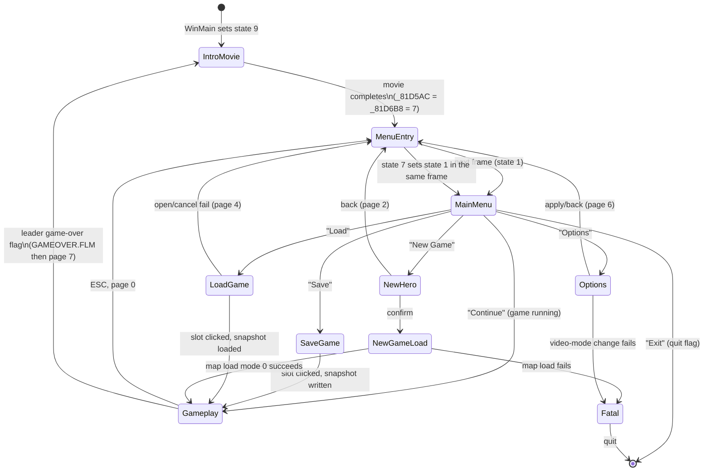

# Konung — game state machine

Target: `konung.res` (PE32/i386, image base `0x400000`,
`sha256 d698c4f231489a372cc25212ab2819720a36d7ce5307a045db684135cf679810`).
All addresses are virtual addresses in `konung.res`.

This is the top-level behavioural model of the shipped game: application
screen states, their transitions, the per-frame sequence, input routing, and
the sub-machines that run inside gameplay. File formats and low-level input
details are in the companion documents listed at the end.

## 1. Two independent state variables

Do not conflate these:

| variable | address | domain | meaning |
|---|---|---|---|
| `_DAT_0081D5AC` | `0x81D5AC` | **top-level screen / application state** | `0..9`; selects which per-frame update+render block runs |
| `_DAT_0081D610` | `0x81D610` | **interface mode inside gameplay** | `0` world, `1` dialogue, `2` quest log, `3` character, `5` **world map / travel** (56 discovered-location flags), `7` inventory detail |
| `_DAT_0081D6B8` | `0x81D6B8` | **menu page selector** | used by states `1`/`7` to choose the MENU page |
| `_DAT_0081D618` | `0x81D618` | quit request | set by `FUN_0043BF5C`; consumed by WndProc |
| `_DAT_0081D5F8` | `0x81D5F8` | “a game was running” | ESC/menu bookkeeping |
| `_DAT_0081D61C` | `0x81D61C` | modal/gate flags | bit 0 gates the gameplay input block; bits 1/2/3 are interface-open requests |

`_DAT_0081D5AC` is initialised to `-1` at WinMain entry (`0x42B1B4`) and set to
`9` immediately after window creation (`0x42B2B0`). Every frame,
`FUN_00436214` (`0x436214`) reads it and dispatches through the jump table at
`0x438048` (`ev_2dc51220a03d87ec13709069686b40bf4ad97442546845786a6b454607d03a04`).

## 2. Top-level states

| id | name | update block | render / screen | entry | exit |
|---|---|---|---|---|---|
| `0` | **GAMEPLAY** | `0x43653F` | world + HUD + interface | resume/new game/load | game over, menu, map transition |
| `1` | **MAIN MENU** | `0x43681E` | MENU page `_81D6B8` | state `7` (first frame) | item select |
| `2` | **NEW HERO** | `0x436D22` | character-creation screen, rect table `0x4604DC` | menu item “new game” | confirm → `8`, back → `7/2` |
| `3` | **FATAL / QUIT** | `0x4377ED` | error message | resolution/map failure | quit |
| `4` | **LOAD GAME** | `0x437802` | 10 save slots (`0x46241C`) | menu item “load” | load → `0`, fail → `7/4` |
| `5` | **SAVE GAME** | `0x437890` | 10 save slots (`0x46241C`) | menu item “save” | save → `0` |
| `6` | **OPTIONS** | `0x437930` | options controls (`0x46257C`) | menu item “options” | apply/back → `7/6`; video fail → `3` |
| `7` | **MENU ENTRY (transient)** | `0x437CE4` | draws the MENU page, then becomes `1` | ESC, movie end, screen back | state `1` next frame |
| `8` | **NEW GAME LOAD (transient)** | `0x437D81` | loading/first map | NEW HERO confirm | state `0`, or `3` on map failure |
| `9` | **INTRO MOVIE** | `0x438021` | `POSTER.FLM` | initial state | movie end → `_81D5AC = _81D6B8` (=`7`) |

The jump-table mapping was decoded from the 10-entry table at `0x438048`:
`0→0x43653F, 1→0x43681E, 2→0x436D22, 3→0x4377ED, 4→0x437802, 5→0x437890,
6→0x437930, 7→0x437CE4, 8→0x437D81, 9→0x438021`.

## 3. State diagram

## 4. Per-frame sequence (`FUN_00436214`)

One invocation per `WM_USER 0x400` (60 ms budget). Order:

1. **Consume exactly one input-ring event** (`ev[16] @ 0x81C154`,
   `flags[16] @ 0x81CF70`, indices `0x81D668/0x81D66C`).
   - Shift/Ctrl down/up → modifier levels `_81D624` / `_81D5E4`.
   - ESC is consumed here and runs the ESC screen switch (below).
   - Any other key-down leaves a “leftover VK” for gameplay.
2. **Mouse button edge latch** → `_DAT_0081D69C` (press edges).
3. If the accumulated mouse delta is non-zero, integrate it
   (`FUN_00428C00`) into the clamped cursor `_81D5C0/_81D5C4`.
4. **Dispatch on `_81D5AC`** (cases below).
5. Return; WndProc then calls `FUN_0042A470` to present the frame and draw the
   software cursor.

### 4.1 Gameplay case `0` (`0x43653F`)

1. If `leader[+4] & 0x80` (leader death/final flag) → set menu page `7`,
   `_81D5F8 = 0`, play `GAMEOVER.FLM` via `FUN_0042ADE4`; the movie-end code
   sets `_81D5AC = _81D6B8 = 7`.
2. Camera follow/scroll `FUN_004353B0` (follow target `_DAT_0081D564`, 0 = free
   camera); interface timer `_DAT_0081D710`.
3. If a portal/transition pending (`_DAT_0081D6D8 < 0`), either post/load the
   destination (`FUN_0043ADF0(0)`) or handle the special “negative location”
   case; camera reset + world redraw.
4. `_DAT_0081D640++` (world tick).
5. World update sequence:
   `FUN_00420F30` → `FUN_00421B50` (group/actor dispatcher) →
   `FUN_00424520` (interface update) → `FUN_0041D048` (death/action pass).
6. **Speed loop:** repeat steps 4–5 `_DAT_0081D634` extra times.
   `_DAT_0081D634` is therefore the **game-speed step count** (`0..2`), changed
   by numpad `*`/`+` (increment, cap 2) and `-` (decrement, floor 0) in
   `FUN_00435B0C`. (This resolves the former “UNKNOWN” meaning of `_81D634`.)
7. Camera pan/audio (`FUN_00428AD8`, `FUN_0043BEBC`), modal flags:
   - `_81D61C & 4` → redraw panel `FUN_0042E520`;
   - `_81D61C & 8` → reopen inventory detail `FUN_00430D6C(0)`.
8. Input block, gated by `_81D61C & 1` and not game-over:
   - leftover key → `FUN_00435B0C(vk)`;
   - mouse/UI → `FUN_0042260C()`.
   The two call sites are `0x4367E5` and `0x43680C`.

### 4.2 Main menu case `1` (`0x43681E`)

1. Hit-test the cursor against the menu item table `0x45B2B4`
   (`FUN_00438798`).
2. `_81D5F8` (game running) changes which items are valid.
3. Play sound `FUN_0042A13C(4,0,0,0)` on click.
4. Dispatch the item index through the table at `0x436CEC`:

| index | target | action |
|---|---|---|
| `0` | `0x436894` | resume: `_81D5AC = 0`, `FUN_0042C384`, `FUN_0042CBD0(-1)`, `FUN_00428F94` |
| `1` | `0x4368C1` | **save**: `_81D5AC = 5`, `FUN_0042C5A0`, build default name from `0x45B394 + (location-1)*0x28`, hit-test slots, `FUN_004304F4(1)` |
| `2` | `0x4369F0` | **load**: `_81D5AC = 4`, `FUN_0042C5A0`, hit-test slots, `FUN_004304F4(0)` |
| `3` | `0x436A2D` | **new game**: `_81D5AC = 2`, initialise the default leader template (portrait, stats, equipment ids, action/animation) |
| `4` | `0x436C79` | **options**: `_81D5AC = 6`, copy settings to `0x831C54..0x831C6C`, `FUN_00430C60(video_mode)` |
| `5` | `0x436CD9` | **exit**: `FUN_0043BF5C("",0)` → quit flag |

### 4.3 New Hero case `2` (`0x436D22`)

- Hit-test `0x4604DC`; left click selects a control.
- Updates the leader template (`0x81D56C`): portrait/palette, class/archetype,
  base/current stats, derived max load/party, equipment/action fields.
- Render helpers `FUN_0042EA6C` (paper doll/character) and `FUN_0042F578`.
- Confirm control `0x437360`: `_81D5AC = 8`.
- Back control `0x437379`: `_81D5AC = 7`, `_81D6B8 = 2`, `_81D5F8 = 0`.

### 4.4 Load case `4` (`0x437802`)

- Draw 10 slots (`FUN_004304F4(0)`), selected slot `_DAT_0081D678`.
- Left click on a valid slot → `FUN_004246C0()`.
- Success → `_81D5AC = 0` (plus portal/camera refresh); failure → `_81D5AC = 7`,
  `_81D6B8 = 4`.

### 4.5 Save case `5` (`0x437890`)

- Draw 10 slots (`FUN_004304F4(1)`); the selected slot shows the editable name
  buffer `0x81CE34`.
- Left click on a valid slot → copy `0x81CE34` to `KONUNG.SAV[slot]`,
  `FUN_00424B3C()` (write `KONUNG.SAV` + `KONUNG.SA<slot>`), then
  `_81D5AC = 0`, refresh and close the interface.

### 4.6 Options case `6` (`0x437930`)

- Hit-test `0x46257C`; toggles the six boolean option flags.
- Apply (`0x437A9A`): `_81D5AC = 7`, `_81D6B8 = 6`, compare the working copy
  `0x831C54..` with the live values, reload FLAMES/sound and re-init video;
  only if video init succeeds, write `KONUNG.CFG`; video-init failure →
  `_81D5AC = 3`.
- Cancel/back (`0x437C39`): restore the live settings from `0x831C54..`,
  `_81D5AC = 7`, `_81D6B8 = 6`.

### 4.7 Menu entry `7` (`0x437CE4`)

- `_81D5AC = 1` immediately; clear mouse delta; close the interface.
- Hit-test the menu items (`0x45B2B4`) for the next frame.
- If menu page `_81D6B8 == 6`, call `FUN_00427698` full-screen; otherwise
  `FUN_0043ABFC` loads/draws the MENU page image.
- Result: the next frame runs **MAIN MENU**.

### 4.8 New-game load `8` (`0x437D81`)

1. Clear interface/selection/camera/input state.
2. Copy the 0x100-byte leader template from `0x81D56C` to `0x81D45C`.
3. `FUN_0043A75C()` (FLAMES.RES) and `FUN_0043A870()` (GAME_x + QUEST_R.RES).
4. Copy the creation-screen values back into the live leader
   (`0x81D4xx → 0x81D56C`).
5. Derive the party/group record `_81D55C`, group activity byte
   (`+0x1B = leader[+0xD6]*3 + 1`), and current location id `_81D6C4`.
6. `FUN_0043ADF0(0)` — **new-game map load mode**.
   Failure → message (`0x450646`) and abort.
7. Center camera, `_81D5AC = 0`, render world, close interface.

### 4.9 Intro movie `9` (`0x438021`)

- `_81D5F8 = 0`, `_81D6B8 = 7`, `FUN_0042ADE4("POSTER.FLM")`.
- `FUN_0042ADE4` calls `PlayAVI.dll`; when the movie ends it executes
  `_81D5AC = _81D6B8` (=`7`) and restores the window/interface.
- If the movie cannot play, it also sets the state to the menu page.

## 5. ESC switch (same function, before the state dispatch)

Handled in `FUN_00436214` at `0x4362D7`–`0x4363C4`; ESC is consumed and never
reaches `FUN_00435B0C`.

| `_81D5AC` | action |
|---|---|
| `0` | `FUN_00428E98`; if `_81D610 == 1` (dialogue) do nothing; else if `_81D610 == 0` → `7`, `_81D5F8 = 1`, `_81D6B8 = 0` (open menu, remember game running); else close the interface (`_81D610 = 0`, `_81D680 = 0`, `FUN_00428F94`) |
| `1` | if `_81D5F8 != 0` → `0`, `_81D6B0 = 0`, `FUN_0042C384`, `FUN_0042CBD0(-1)`, `FUN_00428F94` (resume) |
| `2` | `7`, `_81D5F8 = 0`, menu page `2` |
| `4`, `5` | `7`, `_81D5F8 = 0`, menu page `5` |
| `6` | `7`, menu page `6`; copies the live settings `_81D5AC..` → `0x831C54..` |
| other (`3`,`7`,`8`,`9`) | no-op |

## 6. Input routing matrix

| top-level state | keyboard | mouse |
|---|---|---|
| `0` GAMEPLAY | `FUN_00435B0C(vk)`, one VK per 60 ms, gated by `_81D61C & 1` | `FUN_0042260C` (left/right/hover, full command tree) |
| `1` MAIN MENU | ESC only | state case hit-test `0x45B2B4`, item table `0x436CEC` |
| `2` NEW HERO | ESC only | state case hit-test `0x4604DC`; confirm/back |
| `3` FATAL | none | none |
| `4` LOAD | ESC only | state case hit-test `0x46241C`; click → load |
| `5` SAVE | ESC only | state case hit-test `0x46241C`; click → save |
| `6` OPTIONS | ESC only | state case hit-test `0x46257C` |
| `7` MENU ENTRY | ESC handled before dispatch | state case continues the menu hit-test |
| `8` NEW GAME LOAD | none (single frame) | none |
| `9` INTRO MOVIE | ESC handled before dispatch | movie pump only |

Keyboard details (ring, VK table, modifiers, gates) are in
`KEY_INPUT_SYSTEM.md`; mouse details (button edges, cursor integration, command
compiler, click decision tree) are in `MOUSE_INPUT_SYSTEM.md`.

**Resolved unknown:** `_DAT_0081D634` is the gameplay speed step count (`0..2`),
not a camera zoom. Each extra step runs `FUN_00420F30`/`FUN_00421B50`/
`FUN_00424520`/`FUN_0041D048` once more and increments `_DAT_0081D640`.

## 7. Menu page selector `_DAT_0081D6B8`

| value | observed use | evidence |
|---|---|---|
| `0` | default/ESC menu page (game running) | ESC `0x436331` |
| `2` | New Hero back / ESC from New Hero | `0x43738D`, ESC `0x43638A` |
| `4` | load failure return | `0x437881` |
| `5` | save/load screen return | `0x437921`, ESC `0x4363A3` |
| `6` | options apply/cancel, ESC from options | `0x437AA4`, `0x437C43`, ESC `0x4363BC` |
| `7` | poster / game-over / intro | `0x436569`, `0x43802B` |
| `1`, `3` | not observed as a page in the analysed paths | **UNKNOWN** |

## 8. Sub-machines inside gameplay

### 8.1 World / map load

`FUN_0043ADF0(mode)` loads `LIGHTS.<loc>` and `KONUNG.<loc>`:

- terrain `0x6400` → `0x617FD8`;
- collision `0xC800` → `0x4FAEB0`, converted to the runtime `u16` grid
  `0x4EE6B0`;
- GRAPH placements `0x3E80` → `0x807250`;
- prop records `0x8CA0` → `0x80BD50`;
- group/entity activation, settlement prop linkage, type table `0x81B954`,
  world extent scan.

`mode 0` (new game) additionally places the population, clears object-group
activity, and rebuilds WorldObjects/ground markers. `mode 1` (load) keeps the
snapshot versions. Details are in `KONUNG_SAVE_LOAD.md` §4.4.

### 8.2 Population / AI

- Per-frame dispatcher `FUN_00421B50` selects by group class:
  `&0x40` → `FUN_004123BC` (NPC/monster action machine → `FUN_00412E00`);
  `&0x80` → `FUN_00415FC8` → `FUN_004168A4` (citizen waypoint/wander);
  neither → `FUN_0041ECC8` (party/leader path).
- Object/enemy groups idle while `Group+0x1D == 0`; mode 0 clears it.
- `FUN_00420A8C` is population growth, gated by active group class
  `0x41..0x50` and `Group+0x1C < Group+0x18`.

### 8.3 Actor action / movement

- Order byte `Entity+0x02` (`'H'`, `'D'`, `'A'`, `0x60`) and flags
  `Entity+0x03` (`0x04` battle stance, `0x40` arrival/occupy, `0x80` graphics
  rebuild).
- Movement: click stores destination; next tick `FUN_0041ECC8` →
  `FUN_0043DA1F` (route over the `320×160` collision grid) →
  `FUN_0041435C` (step/animation commit).
- Idle/walk/attack/death rows and animation tables are documented in
  `AGENTS.md` / `KONUNG_SOURCE_OF_TRUTH.md` §16–§17.

### 8.4 Combat / party orders

- `SPACE`/left code `2` → `FUN_00421554` battle/peace stance.
- `A`/left code `5` → `FUN_00421458` party engage.
- `F`/left code `4` → `FUN_0042246C` party halt.
- `1`/`2`/`3`/left code `1` → `FUN_004216DC` active weapon slot.
- Death/action transition `FUN_0041D048`; death animation rows `3`/`9`.

### 8.5 Items / inventory / character screen

- Item instance table in the loaded `GAME_x`, templates/names from the executable.
- Equipment/pickup handlers `FUN_0041E450`, `FUN_0041E6BC`, `FUN_0041E8A8`.
- Character screen entered by state `0` + interface mode `3`
  (`FUN_00424330` → `FUN_0042CBD0(2)`), drawn by `FUN_0042CBD0`.
- World map / travel mode `5` (`FUN_0042CBD0(4)`): `FUN_00428390` draws the
  discovered-location grid; clicking a discovered location returns command
  `index<<8 | 0x103`. The 56-byte flag array `0x81CF80` is the discovered
  location mask; `0x45AE30` marks reserved/unrevealable entries.
- Exchange/inventory-detail mode `7` (`FUN_00430D6C`); trade is opened by the
  quest opcode `0x113` path (`TRADE_SYSTEM.md`), not mode 5.

### 8.6 Dialogue / quest

- Right-click on a human NPC with `Entity+0xD0 != 0xFF` →
  `FUN_00435290` + `FUN_0042CBD0(0)` (interface mode 1).
- Condition/action programs are executed by `FUN_00434FE8`/`FUN_00434BB8`;
  recruit `0x123`, dismiss `0x14C`, trade/loot `0x113`.
- Full trace: `DIALOG_SYSTEM.md`, `QUEST_OPCODES.md`.

### 8.7 Sound

- DirectSound buffers at 22050/19050/25050 Hz (`FUN_00429C0C`).
- `FUN_0042A13C(id,x,y,z)` plays a preloaded clip.
- Sound ids and asset format: `SOUND_SYSTEM.md`.

### 8.8 Movies / game over

- `FUN_0042ADE4(name)` builds `<CD-root>VIDEO\<name>`, calls
  `PlayAVI.dll::playAVIFile`, and on completion restores the window and sets
  `_81D5AC = _81D6B8`.
- `WIN.FLM`, `GAMEOVER.FLM`, `POSTER.FLM` are referenced at `0x450004`,
  `0x45061C`, `0x450655`; `DEFEAT<location>.FLM` is built at runtime from
  `"DEFEAT"` @ `0x4501B0` + location + `".FLM"` @ `0x4501B7`.
- **Victory:** the world-object pickup path (`0x41115B`) sets menu page `7`
  and plays `WIN.FLM`.
- **Defeat:** the path at `0x41D6C3` sets `_81D6B8 = 0` and plays
  `DEFEAT<location>.FLM`; because the movie-end code does `_81D5AC = _81D6B8`,
  it returns to **state `0` (gameplay/respawn)**, not the menu.
- During movie playback `_DAT_0081D5F4 = 1`; the main loop uses blocking
  `GetMessage` and WndProc `WM_USER+0x0D` drives the movie pump.

### 8.9 Projectile / effect pool (`0x80B0D0`, `_DAT_0081D6A0`)

Resolved in the follow-up pass:

- `0x80B0D0` is a **100 × 0x20 effect/projectile pool**; `_DAT_0081D6A0` is the
  active count (`0..100`). It is saved/restored in `KONUNG.SA0..9`.
- `FUN_0041BF44(entity)` allocates an effect at
  `0x80B0D0 + _DAT_0081D6A0*0x20`, projects the entity's destination
  (`Entity+0x0C/+0x0E`) and initialises position, velocity, sprite/colour,
  lifetime (`+0x1D`), entity index and damage/speed fields.
- `FUN_00420F30` is the per-frame pool update: decrements lifetime, moves by
  velocity (`+0x00/+0x04` floats), checks the collision grid and nearby
  entities, applies damage/death (`FUN_0041435C` action 2/3/8/9), and removes
  expired entries by shifting the pool.
- The action machine spawns a projectile in action row `4` and consumes one
  ammo charge from the item table (`0x659B10`); row `5` is the melee branch.

### 8.10 World map / travel screen (interface mode 5)

Resolved in the follow-up pass:

- `_DAT_0081D610 == 5` is the **world map**, not inventory/trade. When
  `_DAT_0081D61C & 2` is set, `FUN_0042A470` clears the bit and calls
  `FUN_00428390`, which draws the 56-location map grid using the pair table
  `0x450EBC` and the per-resolution panel rectangle `0x462BEA`.
- `0x81CF80` is a **56-byte discovered-location mask**; `0x45AE30` marks the
  reserved/unrevealable entries (last 14 bytes are `1`).
- Clicking a discovered location returns `(index << 8) | 0x103` from the mouse
  command compiler; the left-button dispatcher uses the index as the travel
  destination.
- The mask is saved/restored in `KONUNG.SA0..9` (`0x81CF80`, 56 bytes).
- **Location names:** `0x45B394` is a 56-entry CP866 table, stride `0x28`
  (index `0..55`), e.g. `Родники`, `Укромное место`, `Старый лагерь`,
  `Гнездо Дракона`, `Остров`. It is the same table the save screen uses for
  its default name (`location-1`). Full dump:
  `evidence/konung_location_names.csv`.
- The map grid itself draws location markers (indexed sprite blits), not the
  names; the names are used for save defaults/current-location labeling.
- This corrects the earlier “inventory/trade” label in `KEY_INPUT_SYSTEM.md`
  and `MOUSE_INPUT_SYSTEM.md`. Trade/loot is the quest opcode `0x113` path.

### 8.11 Camera follow (`_DAT_0081D564`)

Resolved: `_DAT_0081D564` is the **camera follow target entity pointer**
(`0` = free camera).

- Ctrl+S in `FUN_00435B0C` toggles it between `0` and the leader pointer.
- `FUN_004353B0` is the per-frame follow/scroll routine: it keeps the target's
  projected position inside a dead zone and clamps the camera to the map
  extents; it also handles edge scrolling when the cursor is at the viewport
  border.
- The asset loader initialises it to the leader (`0x4395D3`).

### 8.12 NPC/monster action machine (`FUN_004123BC`)

Resolved top-level graph (per entity, `Entity+0x00` action row):

| row | meaning | behaviour |
|---|---|---|
| `0`, `6` | idle | `FUN_00413DE4` (arrival/anchor); if done, re-enter idle animation `FUN_0041435C` |
| `1`, `7` | walk | gated by `Entity+0x11` tick mask; `+0x10` target; on arrival clears route/queue, sets action idle |
| `2`, `8` | attack | `FUN_00413DE4`; sets group “busy” byte; on completion clears queue |
| `3`, `9` | death | on the second-to-last frame: `'L'` creatures with `+0x12 != 0` spawn a death effect (action `4`); otherwise flags clear and the collision cell is freed |
| `4` | ranged/special | face target, spawn projectile via `FUN_0041BF44`, consume ammo |
| `5` | melee | find adjacent target, resolve hit/damage, death hand-off |

`FUN_004116CC` / `FUN_00412E00` are the group-activity/AI gate; `FUN_0041BF44`
is the projectile spawner; `FUN_00410450` is the post-action cleanup.

## 9. Invariants

- Only **one** top-level state is active per frame.
- Only **one** keyboard event is consumed per frame; ESC is consumed before
  the gameplay dispatcher.
- Mouse state is sampled (not queued); a press is latched into
  `_DAT_0081D69C` and cleared when consumed.
- Gameplay ticks are 60 ms each; `_DAT_0081D634` adds 0–2 extra simulation
  steps per rendered frame.
- Save/load are **full-state snapshots** of the entity, item, world-object,
  marker, settlement and quest tables; load mode deliberately does not rebuild
  them from the map.

## 10. Residual unknowns (after the follow-up pass)

Resolved: `_DAT_0081D564`, `_DAT_0081D6A0`, `0x80B0D0`, `0x81CF80`,
`_DAT_0081D634`, `FUN_004123BC` top-level graph, menu-page 1/3 usage, option
labels, save-name composition, PlayAVI thread existence and body, music/sound
split, exact save-name date format.

Still open:

1. `_DAT_0081D764` — written by the debug numeric keys and initialised to `1`,
   but **no reader exists** in the binary; it is write-only/dead state in this
   build.
2. `_DAT_0081D6B8` values `1` and `3` — no write of either value was found;
   they are unreachable as menu-state selectors. (MENU image `menu640_001` is
   the settings page; that is an image index, not this variable.)
3. No internal game procedures remain unclassified in
   `evidence/konung_res_functions.csv`.

Resolved: `0x03B9` is `MM_MCINOTIFY`; `wParam == 1` resumes MCI music through
`FUN_00429630`.

Resolved detail: PlayAVI thread `0x428150` waits on an event with a 100 ms
timeout and calls video-frame render `0x429FE4`; music is `_81D60C`
(MCI `FUN_004296B0`/`FUN_00429714`), sound effects are `_81D62C` (gates
`FUN_0042A13C`); save name = `Www Mmm dd hh:mm`.

## 11. Companion documents

- `KONUNG_STARTUP_MAIN.md` — entry, WinMain, WndProc, frame loop, threads.
- `KONUNG_SAVE_LOAD.md` — `KONUNG.CFG`, `KONUNG.SAV`, `KONUNG.SA0..9`.
- `KONUNG_FUNCTION_MAP.md` + `evidence/konung_res_functions.csv` — 627-procedure
  inventory.
- `KEY_INPUT_SYSTEM.md`, `MOUSE_INPUT_SYSTEM.md` — input pipeline.
- `KONUNG_SOURCE_OF_TRUTH.md`, `DIALOG_SYSTEM.md`, `SOUND_SYSTEM.md`,
  `QUEST_OPCODES.md` — subsystem contracts.
